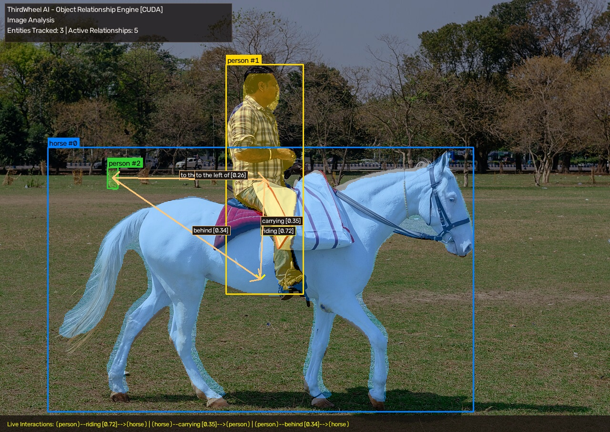

# 🚴 ThirdWheel AI

> **"Always watching. Never invited."**  
> *Real-time open-vocabulary object relationship prediction & visual scene graph engine.*

Traditional computer vision models only answer **"What objects are in the frame?"** (e.g. *Person*, *Horse*).  
**ThirdWheel AI** answers **"What are these objects doing to each other?"** — turning raw pixels into an intelligent, directed knowledge graph like `(person) ──riding [0.81]──▶ (horse)`.

Like an awkward third wheel standing in the corner, it watches every interaction in the scene and tells you the full story.

---

## 📸 Live Visual Demo



*Visual scene graph rendered in real-time: pixel-accurate segmentation contours, entity bounding boxes, and directed relationship arrows with calibrated confidence scores.*

---

## ⚡ How ThirdWheel Enhanced the Cloned Project

ThirdWheel was engineered as a major evolution and upgrade over the original research repository ([RelateAnything](https://github.com/Maelic/RelateAnything)):

| Capability | 🏛️ Original Cloned Project | 🚀 Enhanced in ThirdWheel AI |
| :--- | :--- | :--- |
| **Object Input** | **Manual & Hardcoded:** Required you to manually measure and type box coordinates (`[470, 130, 650, 630]`). Failed on unseen images without manual labels. | **Fully Automated:** Integrates real-time instance segmentation (YOLO-Seg) to automatically detect, classify, and segment all objects in any scene. |
| **Region Conditioning** | **Rectangular Bounding Boxes:** Approximated objects as rigid rectangles, pulling background noise into the visual pooling head. | **Native Pixel Masks:** Feeds exact pixel contours (`[N, H, W]`) directly into the Vision Transformer, boosting spatial precision and relational confidence. |
| **Visual Output** | **Terminal Text Only:** Only printed plain text tuples to stdout (`(person) --riding--> (horse)`). | **Rich Graphic Overlay:** Renders translucent colored masks, entity tags, directional relational arrows, confidence pills, and an analytical HUD directly on the video feed. |
| **Live Camera & Video** | Single-image script only. No integrated webcam launcher. | **Full Multi-Source Pipeline:** Built-in support for live webcams/USB cameras (`--camera 0, 1, 2...`), video files (`.mp4`), and photos. |
| **Compute Hardware** | Standard CPU execution (~1,500 ms per image). | **NVIDIA CUDA GPU Acceleration:** Tuned for NVIDIA RTX GPUs (CUDA 12.4), slashing inference latency down to real-time speeds (~30–50 ms). |
| **Platform & Usability** | Linux bash scripts (`install.sh`, `train.sh`). Missing Windows dependencies (`pycocotools` C-build issues). | **Windows 1-Click Launcher:** Interactive `run_thirdwheel.bat` menu with drag-and-drop file support and pre-compiled Windows compatibility. |

---

## 🎯 Key Features

- 📹 **Live Camera Streaming:** Monitor live webcam feeds or external USB cameras in real-time.
- 🏹 **Directed Relationship Arrows:** Automatically draws color-coded arrows from subjects to objects indicating their interaction.
- 🎨 **Pixel-Accurate Contours:** High-fidelity instance segmentation distinguishes thin and irregular objects (e.g., rider, bicycle, horse legs).
- 🧩 **Two-Graph Decomposition:** Simultaneously extracts **Spatial** graphs (layout: *on top of*, *beside*, *behind*) and **Semantic** graphs (action: *riding*, *holding*, *looking at*).
- ⚡ **Zero-Shot Open Vocabulary:** Define new relationships dynamically at runtime without retraining.
- 🖱️ **1-Click Interactive Batch Launcher:** No complex terminal flags needed; launch with a double-click.

---

## 🚀 Quick Start (Windows)

### 1-Click Interactive Menu

Double-click **`run_thirdwheel.bat`** in File Explorer:

```text
============================================================
       THIRDWHEEL AI - Object Relationship Analyzer
            Always watching. Never invited.
============================================================

SELECT INPUT SOURCE:
  [1] Live Camera / Webcam (Real-Time)
  [2] Image File (Photo Analysis)
  [3] Video File (Recorded Video)

Select option [1, 2, or 3 - Press ENTER for Camera]:
```

> **Pro-Tip (Drag & Drop):** You can drag and drop any image (`.jpg`, `.png`) or video (`.mp4`) directly onto `run_thirdwheel.bat` to analyze it instantly!

---

### Command Line Interface (CLI)

Activate your virtual environment and run `thirdwheel.py`:

```bash
# Activate environment
.venv\Scripts\activate

# 1. Live Webcam (Default Camera 0)
python thirdwheel.py --mode camera --camera 0

# 2. External USB Camera (Camera 1)
python thirdwheel.py --mode camera --camera 1

# 3. Analyze an Image File
python thirdwheel.py --mode image --image assets/reel/images/horse.jpg

# 4. Process a Video File
python thirdwheel.py --mode video --video path/to/video.mp4

# 5. Run in CPU Mode
python thirdwheel.py --mode image --image photo.jpg --device cpu
```

#### CLI Parameters

| Flag | Default | Description |
| :--- | :--- | :--- |
| `--mode` | `image` | Input mode: `camera`, `image`, or `video` |
| `--camera` | `0` | Camera device index (`0` for laptop webcam, `1`, `2` for external USB) |
| `--image` | `assets/reel/images/horse.jpg` | Path to input photo |
| `--video` | `""` | Path to recorded video file |
| `--device` | `auto` | Acceleration hardware: `cuda` (NVIDIA GPU), `cpu`, or `auto` |
| `--output` | `thirdwheel_output.jpg` | Path to save the annotated scene graph output image |
| `--topk` | `5` | Maximum number of top relationships to track per pair |
| `--headless` | `false` | Run without opening the GUI popup window |

---

## 🧠 System Architecture

```
                 Input Frame (Webcam / Image / Video)
                                 │
                                 ▼
               [YOLO-Seg Instance Segmentation]
                 │                           │
           Bounding Boxes              Pixel Masks
                 │                           │
                 └─────────────┬─────────────┘
                               │
                               ▼
            [ThirdWheel Vision Transformer Head]
               (DINOv3 ViT Foundation Model)
                               │
                               ▼
        ┌──────────────────────────────────────────────┐
        │       Open-Vocabulary Decoded Graphs         │
        ├──────────────────────┬───────────────────────┤
        │    Spatial Graph     │    Semantic Graph     │
        │ ("where things are") │ ("what things do")    │
        └──────────────────────┴───────────────────────┘
                               │
                               ▼
                 [Visual Scene Graph Renderer]
     (Mask Contours + Bounding Boxes + Directional Arrows + HUD)
```

---

## ⌨️ Live Window Controls

- **`q`** or **`ESC`**: Exit live webcam stream or video playback.
- **Any Key**: Dismiss analyzed image preview window.

---

## 🛠️ Project Structure

```text
Thirdwheel/
├── thirdwheel.py           # Core application (Camera, Video, Image & GUI overlay)
├── run_thirdwheel.bat      # 1-Click interactive Windows launcher
├── yolo11n-seg.pt          # Instance segmentation neural weights
├── assets/                 # Sample media assets
│   ├── thirdwheel_demo.jpg # Visual scene graph demo preview
│   └── reel/images/        # Sample images (horse, bicycle, cat, etc.)
├── relsgg/                 # Core relationship prediction neural library
│   ├── api.py              # RelateAnything model interface
│   ├── model.py            # RelSGG Vision Transformer architecture
│   ├── vocabulary.py       # Default predicate vocabulary
│   └── decompose.py        # Spatial vs Semantic graph decomposition
├── pyproject.toml          # Project configuration & dependencies
└── README.md               # Documentation
```

---

## 📜 Acknowledgments & Upstream Research

- **[RelateAnything (RelSGG)](https://github.com/Maelic/RelateAnything):** Real-time open-vocabulary relation prediction research by Maëlic Neau.
- **[Meta DINOv3](https://github.com/facebookresearch/dinov3):** Vision Transformer backbone representation.
- **[Ultralytics YOLO](https://github.com/ultralytics/ultralytics):** Real-time instance segmentation.